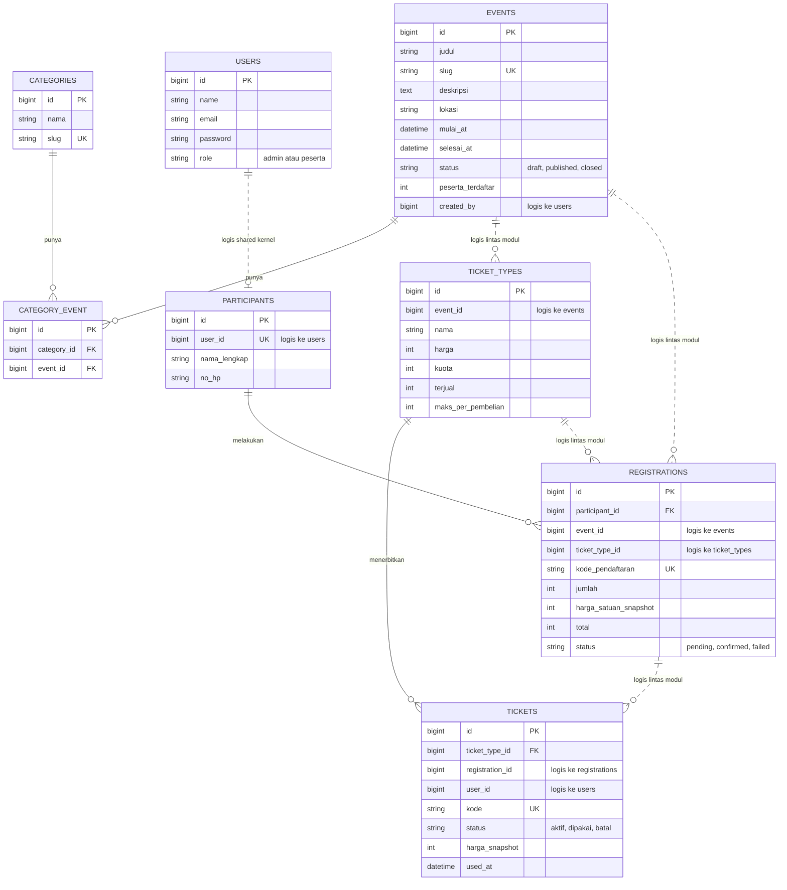

# Entity Relationship Diagram

Keterangan:
- Garis solid: relasi nyata di dalam satu modul (foreign key dan relasi Eloquent).
  - Many-to-Many (EventModule): `categories` dan `events` lewat pivot `category_event`.
  - One-to-Many (TicketModule): `ticket_types` ke `tickets`.
  - One-to-Many (RegistrationModule): `participants` ke `registrations`.
- Garis putus-putus: relasi logis lintas modul. Hanya berupa ID biasa tanpa foreign key dan tanpa relasi Eloquent. Data diambil lewat Contract.
- Kolom snapshot (`harga_snapshot`, `harga_satuan_snapshot`) menyimpan harga saat transaksi agar perubahan harga kemudian tidak mengubah riwayat.